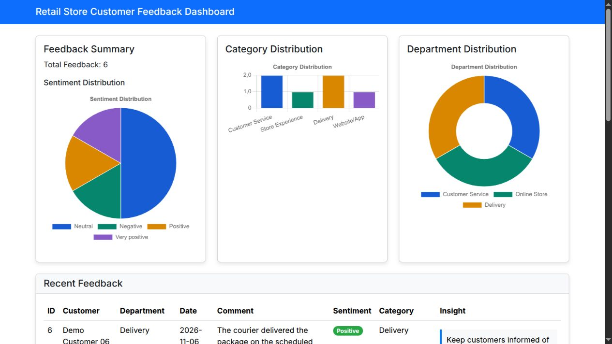

# Customer Feedback Analyzer

Customer Feedback Analyzer turns retail comments into a dashboard of sentiment, feedback categories, and suggested follow-up actions. Stanford CoreNLP classifies the sentiment locally. A Spring Boot service reads the resulting report and can call the Gemini API to categorize comments and suggest actions.

*The screenshot uses synthetic feedback, actual CoreNLP sentiment results, and simulated Gemini categories and suggestions.*

## Project layout

| Directory | Purpose |
| --- | --- |
| [customer-service-platform](customer-service-platform/) | Java CLI that reads feedback and generates a sentiment report. |
| [feedback-service](feedback-service/) | Spring Boot app with a Thymeleaf dashboard at `/` and JSON results at `/getfeedback`. |

## Run the demo

Install **Java 21** and **Maven**. Run these commands from the repository root. The sample input contains six fictional retail comments. The first Maven run downloads the CoreNLP model and other dependencies.

### Generate and copy the sentiment report

~~~bash
cd customer-service-platform
mvn -ntp compile exec:java -Dexec.mainClass=com.retailstore.feedback.SentimentAnalyzer && \
  cp sentiment_feedback_output.txt ../feedback-service/
~~~

Repeat this step when you change the sample feedback. The dashboard reads the copy in `feedback-service` by default. Set `SENTIMENT_FILE` to use a different report.

### Start the dashboard

Switch to the Spring Boot project in the same terminal.

~~~bash
cd ../feedback-service
~~~

To enable Gemini categories and insights, enter and export your API key in Bash before starting Spring Boot. Bash hides the key as you paste it.

~~~bash
read -rsp 'Gemini API key: ' GEMINI_API_KEY
printf '\n'
export GEMINI_API_KEY
~~~

Start Spring Boot from that terminal.

~~~bash
mvn -ntp spring-boot:run
~~~

Open the dashboard after the app starts. Without a key, it still shows sentiment and department totals. Chart.js and Bootstrap load from a CDN. [Local dashboard](http://127.0.0.1:8080/)

The default model is `gemini-3.1-flash-lite`. Set `GEMINI_MODEL` to use another Gemini model that supports structured output. The app sends each comment, department, and sentiment to Gemini on the first request. Use synthetic or appropriately anonymized feedback when enabling enrichment.

The app keeps successful insights in memory for the current report. If a request fails, the dashboard keeps the local sentiment results and identifies entries still awaiting enrichment. Refreshing the page retries those entries.

## Verification

From the repository root, run the tests for the Spring Boot service.

~~~bash
mvn -ntp -f feedback-service/pom.xml test
~~~

The tests cover request authentication and response parsing, reuse of successful results, retry after an HTTP 429 response, and the local-only mode. They use a simulated Gemini response and require no API key.

With the app running, inspect the report via the JSON endpoint.

~~~bash
curl -fsS http://127.0.0.1:8080/getfeedback
~~~

## Attribution

Adapted from the two-part *Build an AI-Enhanced Customer Feedback Platform Using Java and Spring AI* lab in *Generative AI for Java and Spring Development* by IBM and SkillUp on Coursera. The Spring Boot module started from the [IBM Skills Network starter repository](https://github.com/ibm-developer-skills-network/cbnjx-feedback-service).

The portfolio version adds reproducible setup, synthetic demo feedback, configurable Gemini integration via REST, and tests for enrichment and failure handling. The original [Apache 2.0 license](LICENSE) is included.
